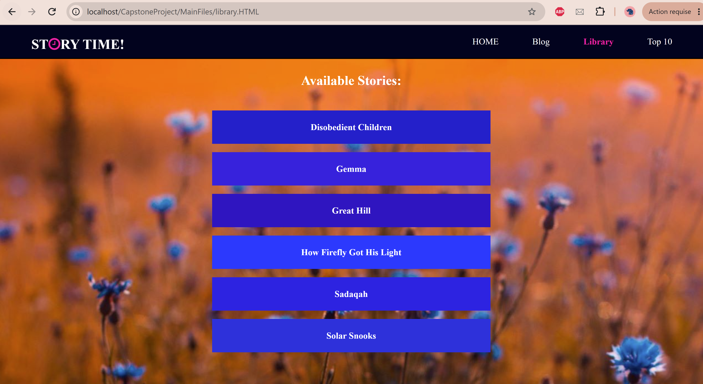
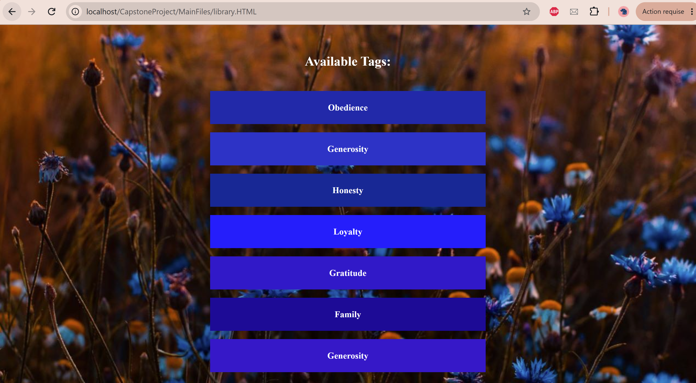
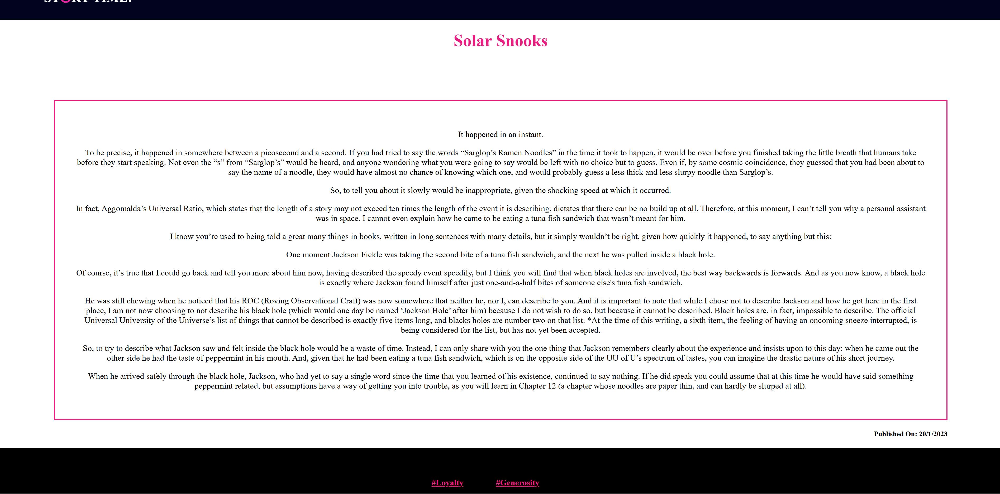
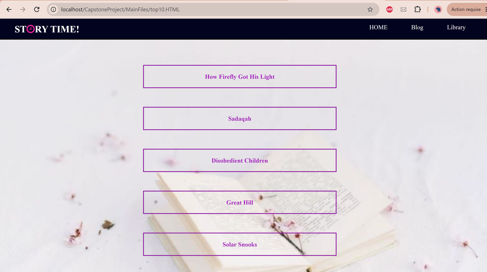
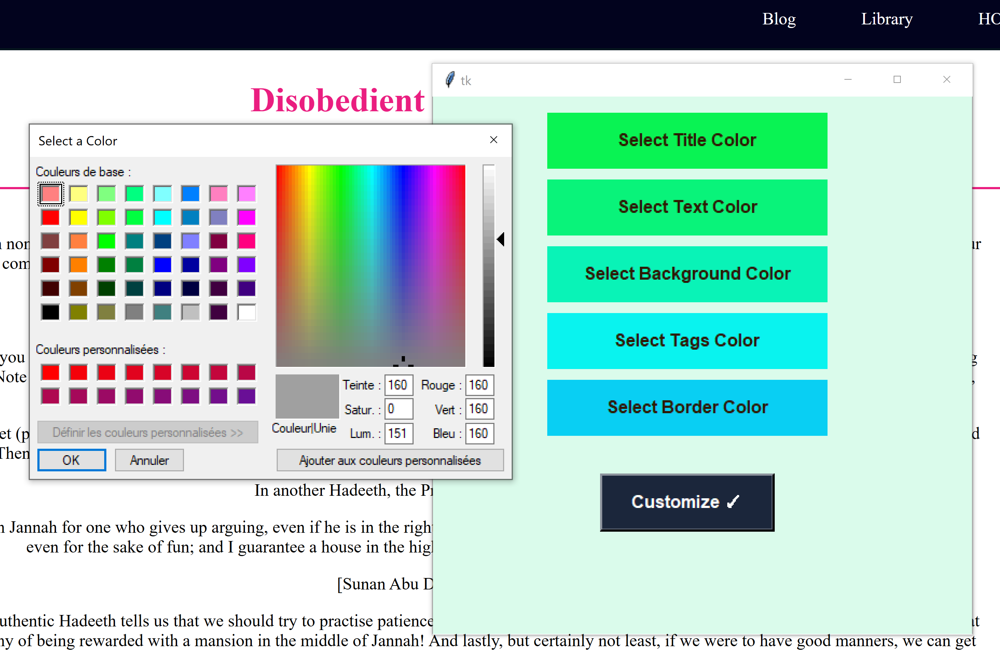

# Story Time – Story Management and Web Log Analysis

This project was developed as my **Bachelor's Thesis at Al Akhawayn University, Morocco (2023)**.

Story Time is a static website that allows users to browse and read stories organized by tags. It integrates Python-based content management, customizable page styling, and Apache access log analysis to identify and display the ten most viewed stories.


## Features

### 1. Story Management
- Generate HTML story pages automatically from structured text files.
- Extract story titles, publication dates, tags, and content.
- Maintain a library of available stories and tags.
- Generate dedicated pages for each tag, linking to related stories.

### 2. Apache Log Analysis
- Parse Apache access logs to identify requests for story pages.
- Count the recorded requests for each story.
- Rank stories based on their request counts.
- Generate a Top 10 Stories page featuring the most viewed available stories.

### 3. Page Customization
- Customize story title, text, background, tag, and border colors.
- Select colors through a Tkinter graphical interface or the command line.
- Apply selected colors by updating CSS properties.

## Screenshots

### Story Library
The library displays the available stories and their associated tags.

**Available Stories**



**Available Tags**



### Story Page
Each story page displays its title, content, publication date, and tags.



### Top 10 Stories


### Page Customization


## Technologies

- **Python:** Story processing, HTML generation, log analysis, and page customization.
- **HTML/CSS:** Website structure and styling.
- **Apache (WAMP):** Local web hosting and access logging.
- **Tkinter:** Graphical interface for color customization.

## Project Structure

```text
static-blog-management-system/
├── Content/                 # Story text files
├── HTMLFiles/               # Generated story and tag pages
├── MainFiles/               # Website pages and stylesheets
├── screenshots/             # Website and GUI screenshots
├── integrate.py             # Story integration
├── update.py                # Story and library generation
├── views.py                 # Apache log analysis and ranking
├── stylePage.py             # Page styling interface
├── stylingStories.css       # Story page styling
├── stylingTags.css          # Tag page styling
└── requirements.txt         # Python dependencies
```

## Installation and Usage

The following instructions assume a Windows environment using WAMP Server.


### 1. Set Up the Project

**Prerequisites:**
- Python 3.10 or later
- WAMP Server (Apache)
- Tkinter (included with standard Python installations on Windows)

The following instructions assume a Windows environment using WAMP Server.

Place the project directory inside:

```text
C:\wamp64\www\static-blog-management-system
```

Create and activate a Python virtual environment:

```bash
python -m venv myenv
myenv\Scripts\activate
```

Install the required external dependency:

```bash
pip install webcolors==25.10.0
```

### 2. Generate Story Pages

Story files are stored in the `Content` directory and follow this structure:

```text
TITLE
The Power of Kindness
DATE
20/10/2023
TAG
#Kindness #Family

Once upon a time...
```

To generate or regenerate all story pages, tag pages, and the library:

```bash
python update.py
```

To integrate a story from the `Content` directory:

```bash
python integrate.py
```

The script prompts for the filename:

```text
Please Enter the New File Name
story.txt
```

Both scripts use the story generation functions in `update.py`. The full update also synchronizes the generated pages with the current contents of the `Content` directory.

### 3. Generate the Top 10 Stories

Run:

```bash
python views.py
```

The script processes Apache's `access.log` file to identify requests for story pages, extract their filenames, and count their occurrences.

It ranks the stories by their recorded request counts and updates the Top 10 Stories page with up to ten of the most viewed stories that still exist in the generated HTML directory.

The Apache access log is typically located at:

```text
C:\wamp64\logs\access.log
```

The log path is configured in `views.py` and can be adjusted to match the local Apache configuration.

### 4. Customize Story Pages

Run:

```bash
python stylePage.py
```

Choose between command-line styling and the Tkinter graphical interface to customize the appearance of story pages.

The selected colors are applied by modifying the corresponding CSS properties.

### 5. Access the Website

Start Apache through WAMP Server and open:

```text
http://localhost/static-blog-management-system/MainFiles/home.html
```

## Project Overview

The project combines static web development with Python automation and Apache web server log analysis. It demonstrates how structured story content can be transformed into interconnected HTML pages, organized through tags, and ranked using access log data.
